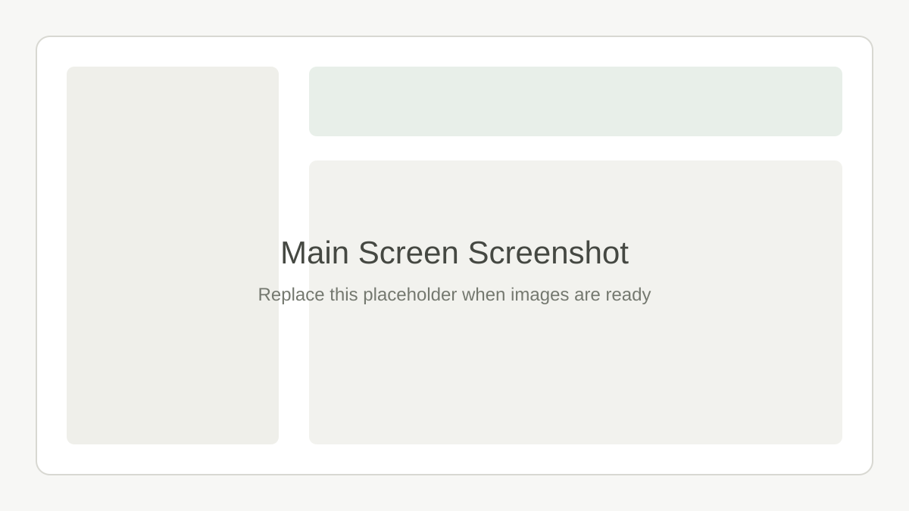
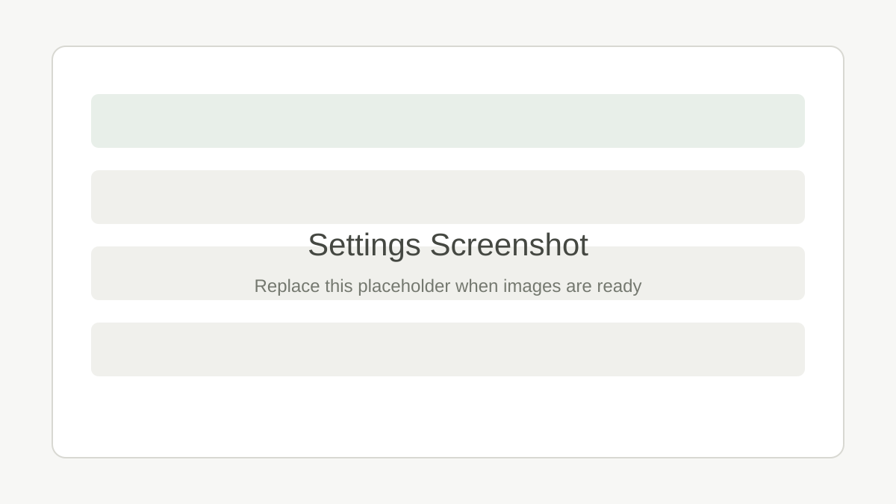
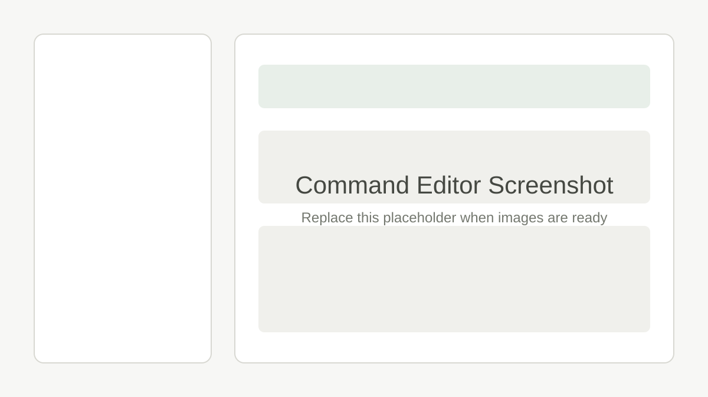

# Nome Voice

Nome Voice is a local voice-command app for Linux.

Say a phrase like `reload`, `open map`, or `pause listening`, and Nome Voice can press
keys, click the mouse, type text, wait, run a small action sequence, or trigger a
system command for you.

It is built for disabled gamers first, but it is also meant to be friendly for casual
players, streamers, Linux tinkerers, and anyone who wants simple voice macros without
sending their audio to the cloud.

## Why This Exists

I have SMA type 2, and gaming on Linux can get tiring fast when every extra key press
costs energy. Sometimes the problem is not the game itself, but the pile of little
inputs around it: reload, map, push to talk, inventory, menus, shortcuts, launchers,
and desktop controls.

I wanted something in the spirit of Voice Attack: say a phrase, fire an action, and get
back to playing. The Linux side needed something that felt local, practical, and built
with disability in mind from the start.

That is why Nome Voice exists.

This project also sits next to my other accessibility tool,
[Nome On-Screen Keyboard](https://github.com/kennykyle/Nome-Linux-On-Screen-Keyboard).
The bigger goal is simple: make Linux gaming and everyday computer use less dependent
on perfect hands, perfect stamina, or perfect hardware setups.

## Who It Is For

- Disabled gamers who want fewer physical inputs between them and the game.
- Casual Linux players who want quick voice shortcuts.
- Streamers who want local commands without cloud voice services.
- People who play on GNOME/Wayland, including Proton games.
- Accessibility tinkerers who like plain JSON profiles and local tools.

## What You Can Do With It

- Make different profiles for different games or apps.
- Add spoken phrases like `reload`, `open map`, `push to talk`, or `emergency stop`.
- Turn phrases into key presses, key combos, held keys, released keys, or toggled keys.
- Click mouse buttons by voice.
- Type short pieces of text.
- Add delays between actions.
- Run action steps one after another or in parallel.
- Pause listening with a voice command.
- Use a large emergency stop button to cancel recognition and release held inputs.
- Choose always-listening mode or push-to-talk mode.
- Tune confidence, command weights, cooldowns, and recognition timing.
- Keep a microphone meter visible even while recognition is paused.
- Start listening when the app opens.
- Start the app automatically when you log into GNOME.
- Import and export profiles as JSON.

## A Few Examples

You can make commands like these:

```text
"reload"        -> press R
"open map"      -> press Ctrl+M
"hold sprint"   -> hold Shift
"stop sprint"   -> release Shift
"push to talk"  -> hold your chat key
"be right back" -> type a short chat message
"panic"         -> emergency stop and release held inputs
```

The idea is not to replace your whole keyboard. It is to take the annoying, repeated,
or physically expensive inputs and make them easier.

## How It Works

Nome Voice listens locally with Vosk, an offline speech recognizer. Your command phrases
come from the active profile, so the recognizer focuses on the words you actually want
to use instead of doing open-ended dictation.

When Nome Voice hears a complete phrase match, it runs the actions attached to that
command. For game-visible input, it uses Linux virtual input through `uinput`.

Audio recognition stays on your machine. No cloud speech service is required.

## Current Support

Nome Voice is early and currently targets this setup:

- Linux
- GNOME
- Wayland
- CachyOS / Arch-based systems

Other desktop environments are not supported yet. KDE Plasma support is on the roadmap.

## Screenshots

Real screenshots can replace these placeholders later.







## Install On CachyOS / Arch

From the repo root:

```bash
bash setup.sh
```

The setup guide checks system packages, `uinput` access, the Vosk model, the desktop
launcher, and the local command-line entry point.

Useful skips:

```bash
bash setup.sh --skip-uinput
bash setup.sh --skip-model
bash setup.sh --skip-gui
bash setup.sh --skip-rust
```

## Run

After setup:

```bash
nome-voice
```

Or open `Nome Voice` from the GNOME app list.

## Debugging

Show the GUI launch log:

```bash
bash scripts/show-gui-log.sh
```

Check the daemon service:

```bash
systemctl --user status nome-voiced.service
```

Test the daemon socket:

```bash
bash scripts/test-daemon.sh
```

## Project Layout

```text
src/nome_voice/             Python GTK app
crates/nome-voice-core/     Rust profile and matcher core
crates/nome-voiced/         Rust daemon scaffold
docs/                       Architecture and tuning notes
examples/                   Example profiles
schemas/                    Profile JSON schema
scripts/                    Setup and debug helpers
setup.sh                    Main installer wrapper
packaging/                  Linux packaging notes and udev rules
packaging/icons/            Desktop icon assets
```

## Notes For Tinkerers

Profiles are plain JSON so they can be backed up, shared, edited, and recovered if the
GUI is not available.

Nome Voice stores config under:

```text
~/.config/nome-voice/
```

It stores app data under:

```text
~/.local/share/nome-voice/
```

The startup toggle writes a per-user GNOME autostart entry at:

```text
~/.config/autostart/local.nomevoice.NomeVoice.desktop
```

More detail lives in:

- `docs/ARCHITECTURE.md`
- `docs/PROFILE_SCHEMA.md`
- `docs/RECOGNITION_TUNING.md`
- `examples/profile.example.json`

## Roadmap

- KDE Plasma support.
- Dictation with Whisper.
- Key and button macro improvements.
- Custom sound execution.
- More system presets, such as volume controls and input blocking.
- Screen-area click targets for saved points or regions.
- Basic scripting experiments.
- Maybe local-only agent or LLM interaction.

## Status

Nome Voice is still early, but the goal is steady: a practical Linux voice macro tool
that gives disabled gamers more ways to play while staying simple enough for anyone to
pick up, customize, and understand.
